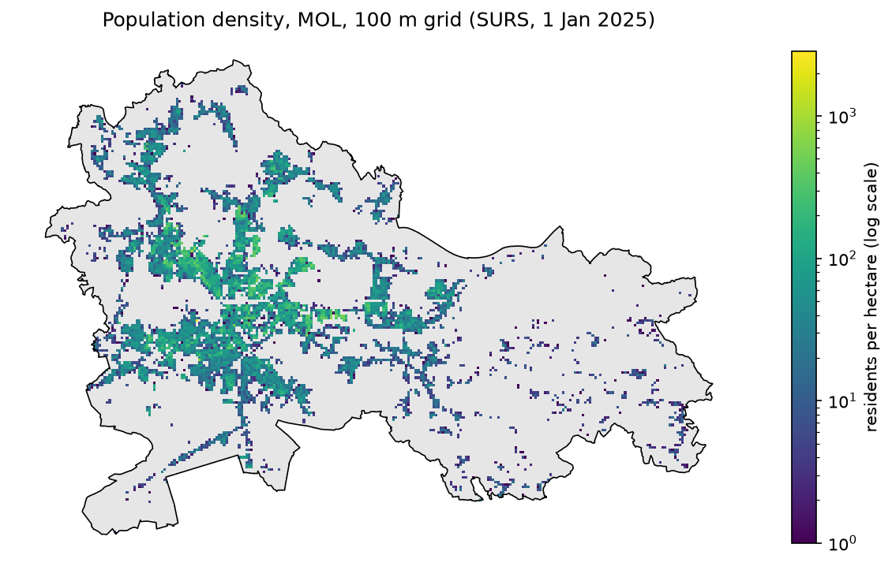
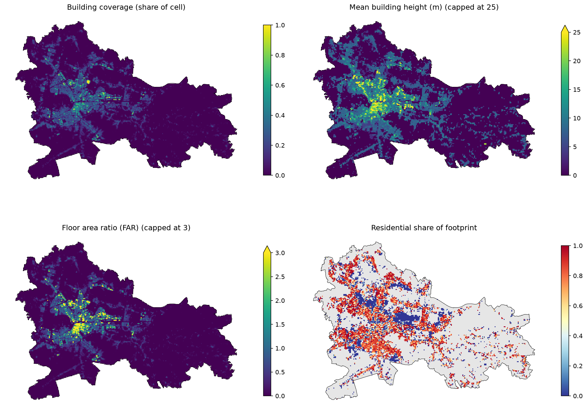
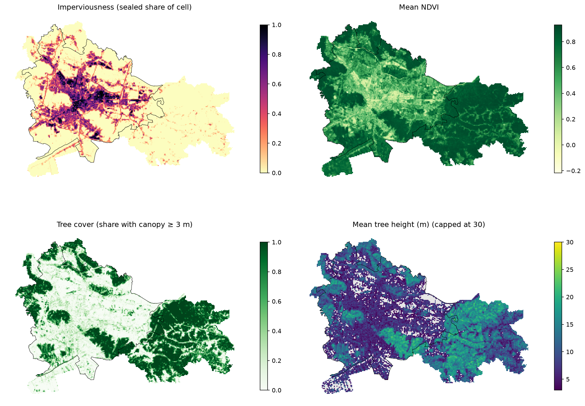

# What we have done so far, explained step by step

*Status: 28 Oct 2026. Covers notebooks `01_grid`, `02_buildings` and `03_land_cover`.*

This document explains **what** we did, **why**, and **how**, in plain language. You don't need to read the code to follow it, but each section says which notebook to open if you want to see the details.

*(Slovene version: `progress_explained_sl.md`.)*

---

## 0. The big picture

The thesis asks: **if we describe every small piece of Ljubljana with numbers (how built-up, how green, how many people, ...) and let an algorithm group similar pieces together, which types of urban areas appear?**

The pipeline we are building has four big stages:

```
1. DATA PREPARATION      2. CLUSTERING          3. PROFILING            4. EVALUATION
cut the city into        group similar cells    describe each group     are the groups stable,
cells, give every cell   (k-means)              ("dense centre",        meaningful, and do they
a few numbers                                    "green suburb", ...)    differ in temperature (LST)?
   ▲
   we are here
```

So far everything we did is **stage 1: data preparation**. We have not clustered anything yet. That is intentional: clustering is only as good as the numbers you feed it, so we make sure every number is correct and understood first.

At the end of stage 1 we want **one big table**:

| cell_id | population | imperviousness | tree cover | building height | ... |
|---|---|---|---|---|---|
| SIHM100_4613_1012 | 0 | 0.98 | 0.00 | 47.4 | ... |
| SIHM100_4733_943 | 0 | 0.00 | 1.00 | 0 | ... |
| ... | | | | | |

One row = one 100 × 100 m square of Ljubljana. One column = one measured property (an **indicator**). This row of numbers is what the thesis calls the cell's **feature vector**.

---

## 1. Basic concepts you need

Read this once and the rest will make sense.

### 1.1 Vector vs raster data
Geographic data comes in two shapes:

- **Vector**: geometric objects with attributes. *Points* (bus stops), *lines* (streets) and *polygons* (buildings, grid cells). Example: "here is a building outline, its height is 12 m".
- **Raster**: a picture made of equal square pixels. Each pixel holds a number. Example: a satellite image where each 10 × 10 m pixel holds "how green is it here".

Our layers come in both shapes, and with different pixel sizes. To compare them, we bring them all to a common unit, **the grid cell**.

### 1.2 Coordinate reference systems (CRS)
A CRS tells you what the coordinates mean. The same point in Ljubljana can be written as:

| CRS | code | coordinates look like | used by |
|---|---|---|---|
| D96/TM (Slovenian national) | EPSG:3794 | 462,000 m east, 101,000 m north | **our grid**, SURS, Slovenian government data |
| ETRS89 / LAEA Europe | EPSG:3035 | 4,670,000 m, 2,560,000 m | Copernicus (EU) products |
| WGS84 longitude/latitude | EPSG:4326 | 14.5°, 46.05° | GPS, Google Earth Engine |

If two layers are in different CRSs, they don't line up: the numbers mean different things. So before combining layers we always **reproject** them, i.e. convert the coordinates into the same system. Our master CRS is **EPSG:3794**, because it is in metres (easy to measure areas) and it is the system our grid comes in.

### 1.3 The grid
We cut Ljubljana into **squares of 100 × 100 m** (1 hectare each). We don't draw these ourselves. We use the official **SURS population grid**, because SURS publishes population data on exactly these squares. Every other layer is summarised onto the same squares.

Each cell has an ID like `SIHM100_4613_1012`. The two numbers are the coordinates of its lower-left corner divided by 100 (E = 461,300 m, N = 101,200 m). This ID is the **key** we use to join all tables together.

### 1.4 Indicator
A single number describing one property of a cell, e.g. "share of the cell covered by buildings = 0.35". We group them by theme: **people**, **built form**, **vegetation**, **function**, **access**.

### 1.5 Zonal statistics
The method for turning a raster into one number per cell: *"take all pixels inside this cell and compute their mean"* (or another statistic). A 10 m raster has 100 pixels in each 100 m cell, and a 1 m raster has about 10,000.

### 1.6 NaN vs 0 (missing vs zero)
This difference matters a lot:
- **0** = we looked and there is nothing. *"This cell has 0 buildings."*
- **NaN** ("not a number") = we don't know, or the value doesn't make sense. *"We have no building data for this cell"*, or *"the average height of the trees in a cell without trees"*.

Writing 0 where we actually don't know would tell the clustering something false.

### 1.7 Correlation
A number between −1 and +1 that says whether two indicators rise together (+1), move in opposite directions (−1), or are unrelated (0). We use **Spearman** correlation, which only looks at the ranking (is A higher when B is higher?), so it works for skewed data too.
Why we care: if two indicators are almost the same (|correlation| close to 1), clustering would count the same information twice, giving it double weight.

### 1.8 Sanity checks (`assert`)
In the notebooks, an `assert` line checks a condition and **stops the notebook with an error** if it's false, e.g. `assert every cell is 100 × 100 m`. This way wrong data can't silently pass through.

---

## 2. Step 1: the grid and population (`notebooks/01_grid.ipynb`)

**Goal:** load the grid, check it is correct, look at population, and save a clean grid that every later step builds on.

### 2.1 Input
The SURS file `prebivalstvo_100m_2025-01-01_ljubljana.gpkg`: population on 1 Jan 2025, already clipped to the municipality of Ljubljana (MOL). It contains **27,505 cells** with 49 SURS variables (total population, age groups, ...).

### 2.2 Checks (all passed)
1. The CRS is EPSG:3794.
2. Every cell ID is unique.
3. Every cell is exactly 100 × 100 m.
4. The ID matches the coordinates.
5. Every cell lies inside MOL. Total area: 275.1 km² of grid vs 275.0 km² of MOL, which matches.

### 2.3 Population: what we learned
- **5,844 cells (21%) are populated**, with **300,443 residents** in total. The other 79% are forest, fields, industry, parks, roads and the river.
- We decide whether a cell is populated using the column `surs_celica`, **not** "population > 0". SURS adds small random noise to the counts for privacy, so 81 populated cells show population 0.
- Because each cell is exactly 1 hectare, the **population count is already population density** (residents per hectare).
- The values are **very skewed**: the median populated cell has 26 residents, but some have hundreds. That's why the map uses a logarithmic colour scale. Otherwise a few dense cells would get all the colour and everything else would look the same.
- One extreme cell, `SIHM100_4603_1014`, holds **2,843 people, mostly aged 20–24: student dorms**. It's real, but an outlier. We flagged it (`collective = True`) to handle it later.



### 2.4 Output
`data/processed/cells.gpkg`, the clean grid with:

| column | meaning | role in the thesis |
|---|---|---|
| `cell_id` | the cell's ID | key for joining |
| `E`, `N` | lower-left corner (m) | location |
| `populated` | SURS has registered residents | flag |
| `collective` | student dorms cell | flag (outlier) |
| `pop` | residents per hectare | **input** (people) |
| `pop_0_14`, `pop_65plus` | children / elderly | **interpretation only, never an input** |

Age groups are deliberately **not inputs**. We will use them afterwards to describe the types, e.g. "type 3 has many elderly residents". This follows the thesis rule against circularity: a variable can't both build the types and describe or validate them.

---

## 3. Step 2: buildings (`notebooks/02_buildings.ipynb`)

**Goal:** turn **75,061 individual buildings** into a few numbers per cell that describe the **built form**: how much is built, how tall, how dense, and what kind of buildings.

### 3.1 Input
**EUBUCCO** (a European building database), an extract for Ljubljana from Špela. Each building is a polygon (its footprint) with height, number of floors, type and so on.

### 3.2 Data quality: what can we trust?
EUBUCCO says for each value whether it was **measured** (from Slovenian government data) or **estimated** by a model:

| attribute | measured (gov) | conclusion |
|---|---|---|
| footprint (outline) | 87% | reliable ✔ |
| height | 80% | reliable ✔ |
| floors | 18% (77% estimated) | not reliable → we **estimate floors from height** (height / 3 m) |
| type (residential, ...) | 0% (67% estimated, 33% OSM) | use with care |
| construction year | 99.8% missing | unusable → would need the GURS cadastre |

### 3.3 Cleaning
**13 buildings had impossible heights** (up to 318 m; Slovenia's tallest building is ~89 m). Several were about 300 m, which is **Ljubljana's elevation above sea level**, stored by mistake in the height field. We replaced them with the typical height of buildings of the same kind. After cleaning, the maximum is 88.3 m.

### 3.4 Coverage problem
The building data covers the **settlement** of Ljubljana (164 km²), not the whole **municipality** MOL (275 km²). So:
- cells mostly inside the data area (16,369 cells) → we compute indicators
- cells outside → indicators are **NaN** ("we don't know"), not 0 ("nothing built")
- **885 populated cells (9,481 residents)** at the edge have no building data. We need to ask Špela for the extract clipped to MOL.

### 3.5 Cutting buildings along cell borders
A building often lies across two or more cells. If we assigned the whole building to one cell, that cell would get too much built area and its neighbour too little. So we **cut every footprint along the grid lines** ("overlay"). Each piece belongs to exactly one cell. 75,061 buildings became 96,351 pieces, and the total footprint area is preserved (100%).

### 3.6 The six indicators

| indicator | how it's computed | what it tells us |
|---|---|---|
| `bld_count` | number of buildings with a piece in the cell | grain: many small vs few large |
| `bld_coverage` | built area / 10,000 m² | how much ground is covered by buildings (0–1) |
| `bld_height` | average height, big footprints weigh more | low vs high-rise |
| `bld_far` | floor area / cell area (**F**loor **A**rea **R**atio) | overall density; FAR 1 = as much floor space as land |
| `bld_footprint_median` | typical footprint size of the cell's buildings | houses (~100 m²) vs blocks and halls (1000+ m²) |
| `bld_residential_share` | residential share of built area | housing vs other uses (less reliable, see 3.2) |

Two details:
- **Height is area-weighted.** A cell with one 20 m block and three garden sheds is a "20 m place", not a "6 m place".
- **Empty cells inside the data area** get count, coverage, FAR and height = 0 (nothing is built, which is meaningful for forest and fields). Footprint and residential share stay NaN, because they're undefined without buildings.

### 3.7 Checks
- The densest cells (highest FAR, up to 14.5) are places we recognise: **Trg republike** (towers + Cankarjev dom) and **BTC (Crystal Palace)**.
- Only 3 of 4,959 populated cells have no building, which is consistent.



### 3.8 Output
`data/processed/ind_buildings.csv`, one row per cell.

---

## 4. Step 3: land cover (`notebooks/03_land_cover.ipynb`)

**Goal:** describe the **ground surface** of each cell: how much is sealed (asphalt, concrete, roofs), how green it is, and how much is covered by trees.

### 4.1 Input: three rasters

| raster | what each pixel means | pixel size | CRS |
|---|---|---|---|
| **Imperviousness** (Copernicus HRL, 2024) | % of the pixel that is sealed (0–100). 255 = outside the mapped area | 10 m | EPSG:3035 |
| **NDVI** (Sentinel-2, from Google Earth Engine) | greenness, from −1 to 1 | ~10 m | EPSG:4326 |
| **Canopy height** (Meta/WRI) | height of tree canopy in m. 0 = no trees | ~1 m | EPSG:4326 |

**What is NDVI?** A satellite measures how much red and near-infrared (NIR) light a surface reflects. Living plants absorb red light (for photosynthesis) and strongly reflect NIR. So
`NDVI = (NIR − Red) / (NIR + Red)`
is high for plants. Rough guide: below 0 water, 0–0.2 bare soil and roofs, 0.2–0.5 sparse vegetation, above 0.6 dense vegetation.

**The first files that arrived** (`.qml`, `.sld`, `.lyr`) were only **colour styles** for QGIS/ArcGIS, not data. They still told us useful facts, such as what value 255 means and which CRS the raster uses.

### 4.2 Checks before computing
- All three rasters cover the **whole** of MOL.
- Inside MOL, the imperviousness raster has no 255 ("outside") pixels and NDVI has no gaps.
- None of the files declares a "no-data" value internally, so we told the code explicitly: ignore 255 in imperviousness and ignore empty (NaN) NDVI pixels.

### 4.3 How we computed the values (zonal statistics)
For every cell: take all pixels whose **centre** lies inside the cell and summarise them.

The rasters are in a different CRS from our grid. We had two options:
1. Reproject the **rasters** into EPSG:3794. This means re-drawing the pixel grid, and each new pixel's value is interpolated from the old ones, so the values change slightly.
2. Reproject the **cells** (just 27,505 squares) into each raster's CRS. The raster values stay exactly as published.

We chose **option 2**. A 100 m square is still practically a square after reprojection, so nothing is lost.

Check: each cell got the expected number of pixels. That's about **100** for imperviousness (10 × 10 m), about **140** for NDVI (in lon/lat its pixels are slightly narrower) and about **14,400** for canopy height. All 27,505 cells got values.

### 4.4 The five indicators

| indicator | how | meaning |
|---|---|---|
| `imp_share` | mean imperviousness / 100 | sealed share of the cell (0–1); includes roads and parking, not only buildings |
| `ndvi_mean` | mean NDVI | overall greenness (grass, crops and trees together) |
| `ndvi_neg_share` | share of pixels with NDVI < 0 | rough hint of water. Not clean: some dark roofs and asphalt are also slightly negative |
| `can_cover` | share of pixels with canopy ≥ 3 m | **tree cover** (where there is shade) |
| `can_height` | mean height of only the tree pixels | young/low vs mature/tall trees; NaN if no trees (2,244 cells) |

**Why two canopy numbers instead of one average?** A cell half covered with 20 m trees and a cell fully covered with 10 m trees have the same overall average (10 m), but they are very different places. Cover and height separate these cases.

**Why 3 m?** Pixels of 0–2 m are mostly grass, shrubs and model noise. 3 m is our choice and can be changed in one line (`TREE_MIN_HEIGHT`).

### 4.5 Sanity checks (all passed)
1. **Imperviousness ≥ building coverage?** Roofs are sealed, so the sealed share must be at least the building share. True in almost all cells: only **28 of 16,369** are more than 10 percentage points below. In built cells, imperviousness is typically **0.23 higher** than building coverage, which is the roads, parking and plazas.
2. **Imperviousness vs NDVI:** a clear, almost straight negative relationship. More concrete means less green, as expected.
3. **Extreme cells make sense:** the most sealed cells have NDVI near 0 and no trees, and the most tree-covered cells are forest (0% sealed, NDVI 0.9).



On the maps you can see the city centre and the main roads (sealed), the forested hills (Rožnik, Golovec, the east of MOL) and Ljubljansko barje in the south-west (green but few trees).

### 4.6 NDVI or canopy height?
The plan says to use **one of them, not both** as a clustering input (an open decision with Špela). We computed both so the decision can be based on numbers:

| pair | correlation | meaning |
|---|---|---|
| NDVI vs imperviousness | **−0.79** | NDVI is largely "the opposite of sealed", so it repeats imperviousness |
| tree cover vs imperviousness | **−0.55** | tree cover carries more information that imperviousness doesn't have |
| NDVI vs tree cover | 0.79 | related, but not the same |
| tree cover vs tree height | 0.88 | almost the same → if canopy, use `can_cover` only |

Also, **about 3,100 cells are green but treeless** (NDVI > 0.6, tree cover < 10%): meadows and fields on Ljubljansko barje, lawns and sports grounds. NDVI can't tell these apart from forest. Tree cover can.

→ **The numbers lean towards `can_cover`.** It adds more beyond imperviousness and separates "green with shade" from "green without shade", which also matters for heat. NDVI is the simpler and more standard choice. **To be decided with Špela.**

### 4.7 Output
`data/processed/ind_land_cover.csv`, one row per cell.

---

## 5. Where we are now

### 5.1 Files

| file | rows | made by | contents |
|---|---|---|---|
| `data/processed/cells.gpkg` | 27,505 | 01 | the grid + population |
| `data/processed/ind_buildings.csv` | 27,505 | 02 | 6 built-form indicators |
| `data/processed/ind_land_cover.csv` | 27,505 | 03 | 5 land-cover indicators |
| `figures/01_…`, `02_…`, `03_….png` | | | maps |

All tables share `cell_id`, so they can be joined into the one big table from section 0.

### 5.2 Progress on the 5 pilot indicators
Supervisor's current proposal for the baseline:

| pilot indicator | status |
|---|---|
| imperviousness | ✅ `imp_share` |
| canopy height or NDVI | ✅ both computed, choice pending |
| population density | ✅ `pop` |
| Urban Atlas land use | ⬜ to do |
| PT accessibility (LPP stops, GTFS) | ⬜ to do |

Buildings (02) are extra built-form indicators beyond the pilot five. We can use them in the baseline or add them later as a separate layer (the "layer ablation" step).

---

## 6. Open questions and limitations

**To ask or decide:**
1. **NDVI vs canopy height** (section 4.6).
2. **Building data for all of MOL:** ask Špela for the EUBUCCO extract clipped to MOL (region SI041). The notebook will work unchanged with the new file.
3. **NDVI time period:** which dates or season does `Ljubljana_NDVI_Export_2026.tif` cover? NDVI changes a lot during the year (fields are bare in winter), so this must be written in the thesis. A summer (June–August) median is usual.
4. **Which cells to cluster:** all 27,505, or only populated or built-up ones? Most of MOL is forest and fields.
5. **Household size** is not in our SURS export. Is a separate SURS file needed?

**Limitations to mention in the thesis:**
- SURS population counts include random noise (privacy protection).
- Building type is mostly model-estimated, and building age is not available.
- Canopy height is a global model, less exact than local lidar.
- The layers come from slightly different years (buildings: EUBUCCO; imperviousness: 2024; population: 2025). This is acceptable because we describe the city's structure, which changes slowly.
- Water is not masked yet (planned with NDWI).

---

## 7. What comes next

1. **Urban Atlas** (land use): share of each land-use class per cell (e.g. 40% residential, 60% industrial). Shares, not class numbers, because a number like "class 3" has no meaning as a quantity.
2. **PT accessibility**: from the LPP stops (GTFS), e.g. distance to the nearest stop or the number of departures nearby.
3. **Water mask** (NDWI).
4. **Combine and standardise**: join all tables and rescale every indicator to mean 0 and standard deviation 1. Otherwise indicators with big numbers (population up to 2,843) would dominate small ones (shares 0–1).
5. **First clustering**: k-means for k = 4…12, choose k, map the clusters, then describe each one ("profiling").

---

## Small glossary

| term | meaning |
|---|---|
| cell | one 100 × 100 m square of the grid |
| indicator | one measured number per cell |
| feature vector | all indicators of one cell (one row of the big table) |
| CRS / EPSG code | coordinate system / its standard ID number |
| reproject | convert coordinates from one CRS to another |
| raster / vector | pixel picture / geometric objects |
| zonal statistics | summarising raster pixels inside each polygon (cell) |
| NaN | missing or undefined value (≠ 0) |
| FAR | floor area ratio: total floor area / land area |
| NDVI | satellite greenness index (−1…1) |
| imperviousness | share of the surface that is sealed (water can't soak in) |
| Spearman correlation | how strongly two indicators rise or fall together (by rank), −1…1 |
| cluster | group of similar cells found by the algorithm |
| urban type | a cluster after we have interpreted and tested it |
| held-out outcome | data deliberately **not** used to build the types, only to test them (Landsat LST) |
