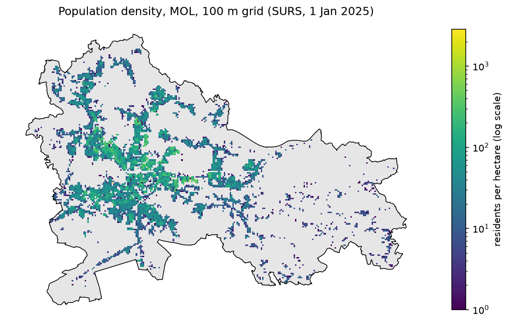
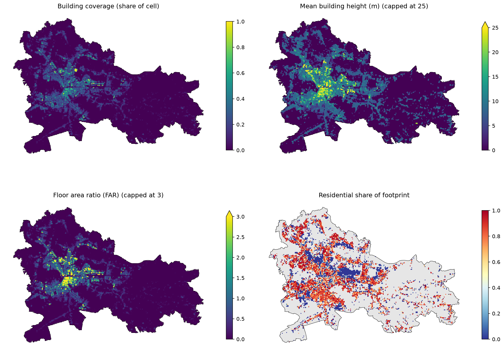
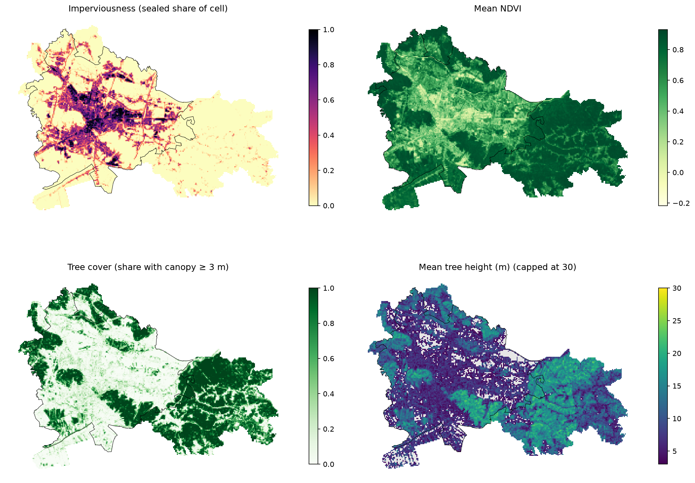

# Kaj smo naredili do zdaj – razlaga korak za korakom

*Stanje: 28. 10. 2026. Zajema zvezke `01_grid`, `02_buildings` in `03_land_cover`.*

Ta dokument v preprostem jeziku razloži, **kaj** smo naredili, **zakaj** in **kako**. Kode ni treba brati, da mu slediš, vendar je pri vsakem razdelku navedeno, kateri zvezek odpreš, če želiš videti podrobnosti.

*(Angleška različica: `progress_explained.md`. Imena stolpcev in datotek ostajajo v angleščini, ker so takšna v kodi.)*

---

## 0. Širša slika

Magistrsko delo sprašuje: **če vsak majhen del Ljubljane opišemo s številkami (kako pozidan je, kako zelen, koliko ljudi tam živi …) in prepustimo algoritmu, da podobne dele združi v skupine, kateri tipi urbanih območij se pokažejo?**

Postopek, ki ga gradimo, ima štiri velike faze:

```
1. PRIPRAVA PODATKOV     2. GRUČENJE            3. PROFILIRANJE          4. VREDNOTENJE
mesto razrežemo na       podobne celice         opišemo vsako gručo      ali so gruče stabilne,
celice, vsaka celica     združimo (k-means)     ("gosto središče",       smiselne in se razlikujejo
dobi nekaj številk                              "zeleno predmestje" …)   po temperaturi (LST)?
   ▲
   tukaj smo
```

Vse, kar smo naredili do zdaj, je torej **faza 1: priprava podatkov**. Gručili še nismo ničesar. To je namerno: gručenje je dobro le toliko, kolikor so dobre številke, ki jih vanj damo. Zato najprej poskrbimo, da je vsaka številka pravilna in razumljena.

Na koncu faze 1 želimo **eno veliko tabelo**:

| cell_id | prebivalci | neprepustnost | pokritost s krošnjami | višina stavb | ... |
|---|---|---|---|---|---|
| SIHM100_4613_1012 | 0 | 0,98 | 0,00 | 47,4 | ... |
| SIHM100_4733_943 | 0 | 0,00 | 1,00 | 0 | ... |
| ... | | | | | |

Ena vrstica je en kvadrat Ljubljane velikosti 100 × 100 m. En stolpec je ena izmerjena lastnost (**kazalnik**). Ta vrstica številk je tisto, čemur v delu rečemo **vektor značilk** (feature vector) celice.

---

## 1. Osnovni pojmi, ki jih potrebuješ

Preberi enkrat, pa bo vse ostalo jasno.

### 1.1 Vektorski in rastrski podatki
Prostorski podatki pridejo v dveh oblikah:

- **Vektorski**: geometrijski objekti z atributi. *Točke* (postajališča), *linije* (ulice) in *poligoni* (stavbe, celice mreže). Primer: »tukaj je obris stavbe, njena višina je 12 m«.
- **Rastrski**: slika iz enakih kvadratnih pikslov. Vsak piksel hrani eno številko. Primer: satelitski posnetek, kjer vsak piksel 10 × 10 m pove, »kako zeleno je tukaj«.

Naši sloji so v obeh oblikah in z različnimi velikostmi pikslov. Da jih lahko primerjamo, jih vse prevedemo na skupno enoto, **celico mreže**.

### 1.2 Koordinatni sistemi (CRS)
Koordinatni sistem pove, kaj koordinate pomenijo. Isto točko v Ljubljani lahko zapišemo kot:

| koordinatni sistem | koda | koordinate so videti kot | kdo ga uporablja |
|---|---|---|---|
| D96/TM (slovenski državni) | EPSG:3794 | 462.000 m vzhod, 101.000 m sever | **naša mreža**, SURS, slovenski državni podatki |
| ETRS89 / LAEA Europe | EPSG:3035 | 4.670.000 m, 2.560.000 m | produkti Copernicus (EU) |
| WGS84 geografska dolžina/širina | EPSG:4326 | 14,5°, 46,05° | GPS, Google Earth Engine |

Če sta dva sloja v različnih koordinatnih sistemih, se ne prekrivata, ker številke pomenijo različne stvari. Zato pred združevanjem slojev vedno naredimo **reprojekcijo**, torej koordinate pretvorimo v isti sistem. Naš glavni sistem je **EPSG:3794**, ker je v metrih (enostavno merjenje površin) in je v njem podana naša mreža.

### 1.3 Mreža
Ljubljano razrežemo na **kvadrate 100 × 100 m** (vsak meri 1 hektar). Ne rišemo jih sami. Uporabimo uradno **SURS-ovo mrežo prebivalstva**, ker SURS objavlja podatke o prebivalstvu prav na teh kvadratih. Vse ostale sloje povzamemo na iste kvadrate.

Vsaka celica ima ID, na primer `SIHM100_4613_1012`. Številki sta koordinati njenega spodnjega levega vogala, deljeni s 100 (E = 461.300 m, N = 101.200 m). Ta ID je **ključ**, s katerim med seboj združujemo vse tabele.

### 1.4 Kazalnik
Ena številka, ki opisuje eno lastnost celice, npr. »delež celice, pokrit s stavbami = 0,35«. Kazalnike razvrščamo po temah: **ljudje**, **grajena oblika**, **vegetacija**, **funkcija**, **dostopnost**.

### 1.5 Conska statistika (zonal statistics)
Metoda, s katero raster pretvorimo v eno številko na celico: *»vzemi vse piksle znotraj te celice in izračunaj njihovo povprečje«* (ali kakšno drugo statistiko). Raster z ločljivostjo 10 m ima v vsaki 100-metrski celici 100 pikslov, raster z ločljivostjo 1 m pa približno 10.000.

### 1.6 NaN ali 0 (manjkajoče ali nič)
Ta razlika je zelo pomembna:
- **0** = pogledali smo in tam ni ničesar. *»V tej celici je 0 stavb.«*
- **NaN** (»not a number«, ni število) = ne vemo, ali pa vrednost nima smisla. *»Za to celico nimamo podatkov o stavbah«* ali *»povprečna višina dreves v celici brez dreves«*.

Če bi napisali 0 tam, kjer v resnici ne vemo, bi gručenju povedali nekaj napačnega.

### 1.7 Korelacija
Število med −1 in +1, ki pove, ali dva kazalnika rasteta skupaj (+1), se gibljeta v nasprotnih smereh (−1) ali nista povezana (0). Uporabljamo **Spearmanov** koeficient. Ta gleda samo vrstni red (ali je A višji, ko je višji B?), zato deluje tudi za asimetrično porazdeljene podatke.
Zakaj nas zanima: če sta dva kazalnika skoraj enaka (|korelacija| blizu 1), bi gručenje isto informacijo štelo dvakrat, torej bi ji dalo dvojno težo.

### 1.8 Preverjanja smiselnosti (`assert`)
V zvezkih vrstica `assert` preveri pogoj in **ustavi zvezek z napako**, če ta ne drži, npr. `assert vsaka celica meri 100 × 100 m`. Tako napačni podatki ne morejo tiho zdrsniti naprej.

---

## 2. Korak 1: mreža in prebivalstvo (`notebooks/01_grid.ipynb`)

**Cilj:** naložiti mrežo, preveriti, da je pravilna, pogledati prebivalstvo in shraniti čisto mrežo, na kateri gradijo vsi nadaljnji koraki.

### 2.1 Vhod
SURS-ova datoteka `prebivalstvo_100m_2025-01-01_ljubljana.gpkg`: prebivalstvo na dan 1. 1. 2025, že obrezano na Mestno občino Ljubljana (MOL). Vsebuje **27.505 celic** s 49 SURS-ovimi spremenljivkami (skupno prebivalstvo, starostne skupine …).

### 2.2 Preverjanja (vsa uspešna)
1. Koordinatni sistem je EPSG:3794.
2. Vsak ID celice je unikaten.
3. Vsaka celica meri natanko 100 × 100 m.
4. ID se ujema s koordinatami.
5. Vsaka celica leži znotraj MOL. Skupna površina: mreža 275,1 km², MOL 275,0 km², kar se ujema.

### 2.3 Prebivalstvo: kaj smo ugotovili
- **5.844 celic (21 %) je naseljenih**, skupaj z **300.443 prebivalci**. Ostalih 79 % so gozdovi, polja, industrija, parki, ceste in reka.
- Ali je celica naseljena, določimo s stolpcem `surs_celica`, **ne** s pogojem »prebivalcev > 0«. SURS zaradi varovanja zasebnosti štetjem doda majhen naključni šum, zato 81 naseljenih celic kaže 0 prebivalcev.
- Ker meri vsaka celica natanko 1 hektar, je **število prebivalcev že gostota prebivalstva** (prebivalci na hektar).
- Vrednosti so **zelo asimetrične**: mediana naseljene celice je 26 prebivalcev, nekatere pa jih imajo več sto. Zato zemljevid uporablja logaritemsko barvno lestvico. Sicer bi nekaj gostih celic pobralo vse barve, vse ostalo pa bi bilo videti enako.
- Ena skrajna celica, `SIHM100_4603_1014`, ima **2.843 ljudi, večinoma starih 20–24 let: študentski domovi**. Celica je resnična, vendar je osamelec. Označili smo jo (`collective = True`), da jo bomo kasneje ustrezno obravnavali.



### 2.4 Izhod
`data/processed/cells.gpkg`, čista mreža s stolpci:

| stolpec | pomen | vloga v delu |
|---|---|---|
| `cell_id` | ID celice | ključ za združevanje |
| `E`, `N` | spodnji levi vogal (m) | lokacija |
| `populated` | SURS ima prijavljene prebivalce | oznaka |
| `collective` | celica s študentskimi domovi | oznaka (osamelec) |
| `pop` | prebivalci na hektar | **vhod** (ljudje) |
| `pop_0_14`, `pop_65plus` | otroci / starejši | **samo za interpretacijo, nikoli vhod** |

Starostne skupine namenoma **niso vhod**. Uporabili jih bomo kasneje za opis tipov, npr. »v tipu 3 živi veliko starejših«. To sledi pravilu proti krožnosti: ista spremenljivka ne sme hkrati graditi tipov in jih opisovati ali preverjati.

---

## 3. Korak 2: stavbe (`notebooks/02_buildings.ipynb`)

**Cilj:** **75.061 posameznih stavb** pretvoriti v nekaj številk na celico, ki opisujejo **grajeno obliko**: koliko je pozidano, kako visoko, kako gosto in kakšne so stavbe.

### 3.1 Vhod
**EUBUCCO** (evropska baza stavb), izsek za Ljubljano, ki ga je pripravila Špela. Vsaka stavba je poligon (njen tloris) z višino, številom etaž, tipom ipd.

### 3.2 Kakovost podatkov: čemu lahko zaupamo?
EUBUCCO za vsako vrednost pove, ali je bila **izmerjena** (iz slovenskih državnih podatkov) ali **ocenjena** z modelom:

| atribut | izmerjeno (država) | sklep |
|---|---|---|
| tloris (obris) | 87 % | zanesljivo ✔ |
| višina | 80 % | zanesljivo ✔ |
| število etaž | 18 % (77 % ocenjenih) | ni zanesljivo → **etaže ocenimo iz višine** (višina / 3 m) |
| tip (stanovanjska …) | 0 % (67 % ocenjenih, 33 % OSM) | uporabljati previdno |
| leto izgradnje | 99,8 % manjka | neuporabno → potrebovali bi kataster GURS |

### 3.3 Čiščenje
**13 stavb je imelo nemogoče višine** (do 318 m; najvišja stavba v Sloveniji meri ~89 m). Več jih je imelo okoli 300 m, kar je **nadmorska višina Ljubljane**, pomotoma zapisana v polje za višino. Nadomestili smo jih s tipično višino stavb iste vrste. Po čiščenju je največja višina 88,3 m.

### 3.4 Težava s pokritostjo
Podatki o stavbah pokrivajo **naselje** Ljubljana (164 km²), ne pa celotne **občine** MOL (275 km²). Zato:
- za celice, ki večinoma ležijo znotraj območja podatkov (16.369 celic), izračunamo kazalnike
- celice zunaj imajo kazalnike **NaN** (»ne vemo«), ne 0 (»nič pozidanega«)
- **885 naseljenih celic (9.481 prebivalcev)** na robu nima podatkov o stavbah. Špelo moramo prositi za izsek, obrezan na MOL.

### 3.5 Rezanje stavb po mejah celic
Stavba pogosto leži v dveh ali več celicah. Če bi celo stavbo pripisali eni celici, bi ta dobila preveč pozidane površine, njena soseda pa premalo. Zato smo **vsak tloris razrezali po črtah mreže** (»overlay«). Vsak kos pripada natanko eni celici. Iz 75.061 stavb je nastalo 96.351 kosov, skupna površina tlorisov pa je ohranjena (100 %).

### 3.6 Šest kazalnikov

| kazalnik | kako se izračuna | kaj nam pove |
|---|---|---|
| `bld_count` | število stavb, ki imajo kos v celici | zrnatost: veliko majhnih ali malo velikih |
| `bld_coverage` | pozidana površina / 10.000 m² (≈ **faktor zazidanosti**) | koliko tal pokrivajo stavbe (0–1) |
| `bld_height` | povprečna višina, večji tlorisi štejejo več | nizka ali visoka gradnja |
| `bld_far` | bruto etažna površina / površina celice (**faktor izrabe**, angl. FAR) | skupna gostota; FAR 1 = toliko etažne površine kot zemljišča |
| `bld_footprint_median` | tipična velikost tlorisa stavb v celici | hiše (~100 m²) ali bloki in hale (1000+ m²) |
| `bld_residential_share` | stanovanjski delež pozidane površine | stanovanja ali druge rabe (manj zanesljivo, glej 3.2) |

Dve podrobnosti:
- **Višina je utežena s površino.** Celica z enim 20-metrskim blokom in tremi vrtnimi lopami je »20-metrski kraj«, ne »6-metrski kraj«.
- **Prazne celice znotraj območja podatkov** dobijo število, pokritost, FAR in višino = 0 (nič ni pozidano, kar je smiselna informacija za gozd in polja). Tloris in stanovanjski delež ostaneta NaN, ker brez stavb nista definirana.

### 3.7 Preverjanja
- Najgostejše celice (najvišji FAR, do 14,5) so kraji, ki jih poznamo: **Trg republike** (stolpnici + Cankarjev dom) in **BTC (Kristalna palača)**.
- Le 3 od 4.959 naseljenih celic nimajo nobene stavbe, kar je skladno.



### 3.8 Izhod
`data/processed/ind_buildings.csv`, ena vrstica na celico.

---

## 4. Korak 3: pokrovnost tal (`notebooks/03_land_cover.ipynb`)

**Cilj:** opisati **površje** vsake celice: koliko je zapečateno (asfalt, beton, strehe), kako zeleno je in koliko ga pokrivajo drevesa.

### 4.1 Vhod: trije rastri

| raster | kaj pomeni vsak piksel | velikost piksla | koordinatni sistem |
|---|---|---|---|
| **Neprepustnost** (Copernicus HRL, 2024) | % piksla, ki je zapečaten (0–100). 255 = zunaj kartiranega območja | 10 m | EPSG:3035 |
| **NDVI** (Sentinel-2, iz Google Earth Engine) | zelenost, od −1 do 1 | ~10 m | EPSG:4326 |
| **Višina krošenj** (Meta/WRI) | višina drevesnih krošenj v m. 0 = ni dreves | ~1 m | EPSG:4326 |

**Kaj je NDVI?** Satelit izmeri, koliko rdeče in bližnje infrardeče (NIR) svetlobe površina odbije. Žive rastline rdečo svetlobo absorbirajo (za fotosintezo), NIR pa močno odbijajo. Zato je
`NDVI = (NIR − rdeča) / (NIR + rdeča)`
visok za rastline. Groba vodila: pod 0 voda, 0–0,2 gola tla in strehe, 0,2–0,5 redka vegetacija, nad 0,6 gosta vegetacija.

**Prve datoteke, ki so prispele** (`.qml`, `.sld`, `.lyr`), so bile le **barvni slogi** za QGIS/ArcGIS, ne podatki. Kljub temu so nam povedale koristne stvari, na primer kaj pomeni vrednost 255 in v katerem koordinatnem sistemu je raster.

### 4.2 Preverjanja pred izračunom
- Vsi trije rastri pokrivajo **celotno** MOL.
- Znotraj MOL raster neprepustnosti nima pikslov z vrednostjo 255 (»zunaj«), NDVI pa nima vrzeli.
- Nobena datoteka nima vpisane vrednosti za »ni podatka«, zato smo kodi to povedali izrecno: pri neprepustnosti prezri 255, pri NDVI prezri prazne (NaN) piksle.

### 4.3 Kako smo izračunali vrednosti (conska statistika)
Za vsako celico: vzemi vse piksle, katerih **središče** leži v celici, in jih povzemi.

Rastri so v drugem koordinatnem sistemu kot naša mreža. Imeli smo dve možnosti:
1. **Rastre** reprojicirati v EPSG:3794. To pomeni ponovno izrisati mrežo pikslov, pri čemer se vrednost vsakega novega piksla interpolira iz starih, torej se vrednosti nekoliko spremenijo.
2. **Celice** (samo 27.505 kvadratov) reprojicirati v koordinatni sistem vsakega rastra. Vrednosti rastra ostanejo natanko takšne, kot so bile objavljene.

Izbrali smo **možnost 2**. Kvadrat 100 m je po reprojekciji še vedno praktično kvadrat, zato ne izgubimo ničesar.

Preverjanje: vsaka celica je dobila pričakovano število pikslov. To je približno **100** za neprepustnost (10 × 10 m), približno **140** za NDVI (v geografskih koordinatah so njegovi piksli nekoliko ožji) in približno **14.400** za višino krošenj. Vseh 27.505 celic je dobilo vrednosti.

### 4.4 Pet kazalnikov

| kazalnik | kako | pomen |
|---|---|---|
| `imp_share` | povprečna neprepustnost / 100 | zapečateni delež celice (0–1); vključuje ceste in parkirišča, ne le stavb |
| `ndvi_mean` | povprečni NDVI | splošna zelenost (trava, posevki in drevesa skupaj) |
| `ndvi_neg_share` | delež pikslov z NDVI < 0 | groba nakazanost vode. Ni čista: tudi nekatere temne strehe in asfalt so rahlo negativni |
| `can_cover` | delež pikslov s krošnjami ≥ 3 m | **pokritost z drevesi** (kje je senca) |
| `can_height` | povprečna višina samo drevesnih pikslov | mlada/nizka ali zrela/visoka drevesa; NaN, če dreves ni (2.244 celic) |

**Zakaj dve številki za krošnje namesto enega povprečja?** Celica, ki jo do polovice pokrivajo 20-metrska drevesa, in celica, ki jo v celoti pokrivajo 10-metrska drevesa, imata enako skupno povprečje (10 m), a sta zelo različna kraja. Pokritost in višina ta primera ločita.

**Zakaj 3 m?** Piksli z 0–2 m so večinoma trava, grmovje in šum modela. 3 m je naša izbira, ki jo lahko spremenimo v eni vrstici (`TREE_MIN_HEIGHT`).

### 4.5 Preverjanja smiselnosti (vsa uspešna)
1. **Neprepustnost ≥ pokritost s stavbami?** Strehe so zapečatene, zato mora biti zapečateni delež vsaj tolikšen kot delež stavb. To drži v skoraj vseh celicah: le **28 od 16.369** jih je za več kot 10 odstotnih točk nižje. V pozidanih celicah je neprepustnost tipično **za 0,23 višja** od pokritosti s stavbami, kar so ceste, parkirišča in trgi.
2. **Neprepustnost in NDVI:** jasna, skoraj premočrtna negativna povezava. Več betona pomeni manj zelenja, kot pričakovano.
3. **Skrajne celice so smiselne:** najbolj zapečatene celice imajo NDVI blizu 0 in nič dreves, celice z največ drevesi pa so gozd (0 % zapečatenosti, NDVI 0,9).



Na zemljevidih se vidijo mestno središče in glavne vpadnice (zapečateno), gozdnati griči (Rožnik, Golovec, vzhodni del MOL) in Ljubljansko barje na jugozahodu (zeleno, a z malo drevesi).

### 4.6 NDVI ali višina krošenj?
Načrt pravi, da kot vhod za gručenje uporabimo **enega od njiju, ne obeh** (odprta odločitev s Špelo). Izračunali smo oba, da lahko odločitev temelji na številkah:

| par | korelacija | pomen |
|---|---|---|
| NDVI in neprepustnost | **−0,79** | NDVI je v veliki meri »nasprotje zapečatenega«, torej ponavlja neprepustnost |
| pokritost z drevesi in neprepustnost | **−0,55** | pokritost z drevesi nosi več informacije, ki je neprepustnost nima |
| NDVI in pokritost z drevesi | 0,79 | povezana, a ne enaka |
| pokritost z drevesi in višina dreves | 0,88 | skoraj enaka → če krošnje, potem samo `can_cover` |

Poleg tega je **približno 3.100 celic zelenih, a brez dreves** (NDVI > 0,6, pokritost z drevesi < 10 %): travniki in polja na Ljubljanskem barju, trate in športna igrišča. NDVI jih ne loči od gozda. Pokritost z drevesi jih.

→ **Številke so bolj naklonjene `can_cover`.** Doda več prek neprepustnosti in loči »zeleno s senco« od »zelenega brez sence«, kar je pomembno tudi za vročino. NDVI je preprostejša in bolj standardna izbira. **Odločimo skupaj s Špelo.**

### 4.7 Izhod
`data/processed/ind_land_cover.csv`, ena vrstica na celico.

---

## 5. Kje smo zdaj

### 5.1 Datoteke

| datoteka | vrstic | naredil | vsebina |
|---|---|---|---|
| `data/processed/cells.gpkg` | 27.505 | 01 | mreža + prebivalstvo |
| `data/processed/ind_buildings.csv` | 27.505 | 02 | 6 kazalnikov grajene oblike |
| `data/processed/ind_land_cover.csv` | 27.505 | 03 | 5 kazalnikov pokrovnosti tal |
| `figures/01_…`, `02_…`, `03_….png` | | | zemljevidi |

Vse tabele imajo skupen stolpec `cell_id`, zato jih lahko združimo v eno veliko tabelo iz razdelka 0.

### 5.2 Napredek pri 5 pilotnih kazalnikih
Trenutni predlog mentorice za izhodiščni model:

| pilotni kazalnik | stanje |
|---|---|
| neprepustnost | ✅ `imp_share` |
| višina krošenj ali NDVI | ✅ izračunana oba, izbira odprta |
| gostota prebivalstva | ✅ `pop` |
| raba tal Urban Atlas | ⬜ še za narediti |
| dostopnost JPP (postajališča LPP, GTFS) | ⬜ še za narediti |

Stavbe (02) so dodatni kazalniki grajene oblike, ki presegajo pet pilotnih. Lahko jih uporabimo v izhodiščnem modelu ali pa jih kasneje dodamo kot ločen sloj (korak »ablacije slojev«).

---

## 6. Odprta vprašanja in omejitve

**Za vprašati ali odločiti:**
1. **NDVI ali višina krošenj** (razdelek 4.6).
2. **Podatki o stavbah za celotno MOL:** Špelo prositi za izsek EUBUCCO, obrezan na MOL (regija SI041). Zvezek bo z novo datoteko deloval brez sprememb.
3. **Časovno obdobje NDVI:** katere datume oziroma letni čas pokriva `Ljubljana_NDVI_Export_2026.tif`? NDVI se čez leto močno spreminja (polja so pozimi gola), zato mora biti to zapisano v delu. Običajna izbira je poletna (junij–avgust) mediana.
4. **Katere celice gručiti:** vseh 27.505 ali samo naseljene oziroma pozidane? Večino MOL predstavljajo gozd in polja.
5. **Velikost gospodinjstev** ni v našem SURS-ovem izvozu. Ali potrebujemo ločeno datoteko SURS?

**Omejitve, ki jih omenimo v delu:**
- Štetja prebivalcev SURS vsebujejo naključni šum (varovanje zasebnosti).
- Tip stavbe je večinoma ocenjen z modelom, starost stavb pa ni na voljo.
- Višina krošenj je globalni model, manj natančen od lokalnega lidarja.
- Sloji so iz nekoliko različnih let (stavbe: EUBUCCO; neprepustnost: 2024; prebivalstvo: 2025). To je sprejemljivo, ker opisujemo zgradbo mesta, ki se spreminja počasi.
- Voda še ni maskirana (načrtovano z NDWI).

---

## 7. Naslednji koraki

1. **Urban Atlas** (raba tal): delež vsakega razreda rabe tal na celico (npr. 40 % stanovanjsko, 60 % industrijsko). Deleži in ne številke razredov, ker številka, kot je »razred 3«, nima pomena kot količina.
2. **Dostopnost JPP**: iz postajališč LPP (GTFS), npr. razdalja do najbližjega postajališča ali število odhodov v bližini.
3. **Maska vode** (NDWI).
4. **Združiti in standardizirati**: združiti vse tabele in vsak kazalnik preskalirati na povprečje 0 in standardni odklon 1. Sicer bi kazalniki z velikimi številkami (prebivalci do 2.843) prevladali nad majhnimi (deleži 0–1).
5. **Prvo gručenje**: k-means za k = 4…12, izbira k, zemljevid gruč, nato opis vsake gruče (»profiliranje«).

---

## Kratek slovarček

| izraz | pomen |
|---|---|
| celica | en kvadrat mreže velikosti 100 × 100 m |
| kazalnik (indicator) | ena izmerjena številka na celico |
| vektor značilk (feature vector) | vsi kazalniki ene celice (ena vrstica velike tabele) |
| koordinatni sistem / koda EPSG | sistem koordinat / njegova standardna identifikacijska številka |
| reprojekcija | pretvorba koordinat iz enega koordinatnega sistema v drugega |
| raster / vektor | slika iz pikslov / geometrijski objekti |
| conska statistika (zonal statistics) | povzemanje rastrskih pikslov znotraj vsakega poligona (celice) |
| NaN | manjkajoča ali nedefinirana vrednost (≠ 0) |
| faktor izrabe (FAR) | bruto etažna površina / površina zemljišča |
| faktor zazidanosti | pozidana površina / površina zemljišča (naš `bld_coverage`) |
| NDVI | satelitski indeks zelenosti (−1…1) |
| neprepustnost (imperviousness) | delež površja, ki je zapečaten (voda ne more pronicati v tla) |
| Spearmanova korelacija | kako močno dva kazalnika skupaj naraščata ali padata (po vrstnem redu), −1…1 |
| gruča (cluster) | skupina podobnih celic, ki jo najde algoritem |
| urbani tip | gruča, ko jo interpretiramo in preverimo |
| zadržana spremenljivka (held-out outcome) | podatki, ki jih namenoma **ne** uporabimo za gradnjo tipov, ampak samo za njihovo preverjanje (Landsat LST) |
